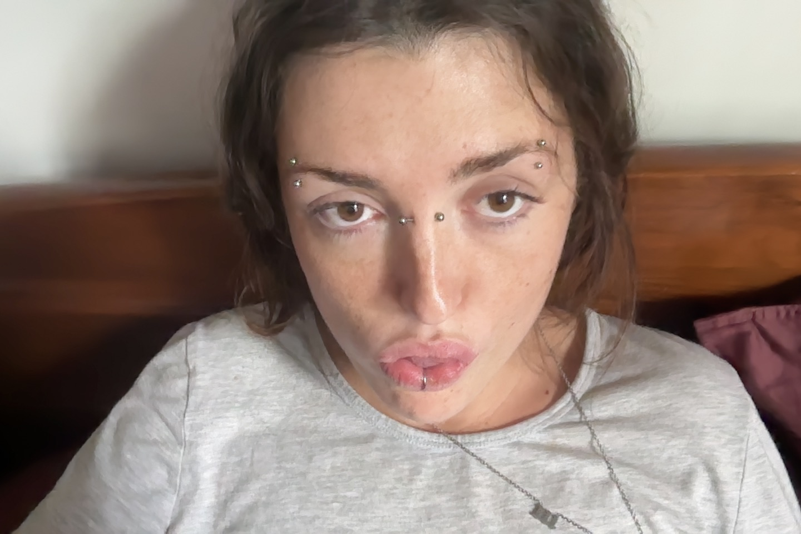

---
{"dg-publish":true,"permalink":"/daily-entry/01-11-2026/","dg-note-properties":{}}
---

Dear Reader, 
A third of the way through our final quarter. I awake. A handsome five-hour sleep. Sometimes I think I can see the air. I have been told it is visual snow, but it's not. It's lines that aren't floaters. Probably all the screen time.

I called Graham, 82, this morning, and he told me he couldn't be bothered to match with me ahead of this evening's meeting. I laughed. But the laugh was a lie. Because I am so tired all the time, I struggle to emotionally regulate as much. I find I cruise around constantly with millions of tears in my ducts and dam I feel silly. Petulant? I don't know why people insist on saying they will do things when I am then expected to infer that they actually do not mean it! It is confusing, and it embarrasses me. But it is fine. I know I am just feeling extra sensitive at the moment.

So sensitive that last night, after work, all I could think about was going on a drug binge! Delicious! It is good to notice what brings these feelings on, and why, because I suppose it is these very feelings, and my maladaptive responses to them, that have given rise to my addiction. I think the emotional exhaustion stems from what I am doing in EMDR (which would check out). I am so emotionally drained, so often. It's hard! It is making me quite angry!

Before, I would go on my anger walks, but now I feel strong impulses to hit things. I always have the residue of punches on my right hand, which I don't particularly like, only because it is 'unladylike'.

One of my bosses at work has feelings beyond professionalism towards me. I cannot tell if she wants to be my good friend or have sex with me, but either way, it affords me a very, very long leash. It is almost insulting to my colleagues, the slack and privileges I receive. She has been spoken to by her superiors, of which there are few, about her clear favouritism towards me. I was worried it would relent. It hasn't. It is the only saving grace.

She is terrifying to my colleagues, and she does also scare me slightly, but I think she has extremely sweet and childlike eyes, so I treat her as such, and she is warm to it. When she loses her temper and is truly a pain, I try to sidle over and make her laugh. It's called people management. No one else is bothered by my favouritism; it is the cross I must bear. She tells me I am NQR (not quite right). It's true, I am not, particularly at work. Being at work often makes me want to kill myself or relapse. I do think I should probably look for another industry to work in. I dread going in. I don't have the spoons nor the minerals to manage the feelings and expectations of every Tom, Dick and Hungry. 

Today this is me. 

Goodbye! 
Miss Hooch 