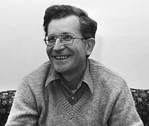

---
{"dg-publish":true,"permalink":"/daily-entry/02-11-2026/","dg-note-properties":{"description":"Exes, jobs and anarchism"}}
---

Dear reader,
me and my ex have been broken up for quite some time. I have seen he has a new girlfriend and i feel the most pronounced and profound sense of relief. I cannot stop sighing and my chest feels lighter. I can't work out why this might be the case. I feel totally free, I feel no sense of jealousy, I am so so so relieved that that horrendously painful and drawn out period of my life has come to a close. This individual absolutely decimated my self-esteem, my gut microbiome and my perception of love and trust. I wish the new girlfriend all the luck, love and happiness. I hope she knows to never feel threat from me and that I am in her corner. I am so glad to be free from whatever cosmic shackles routinely and bizarrely kept us clairvoyantly attached. I hope we may all be able to be happy now. It is a beautiful to discover that the past no longer has any claim over the future and that I can now be entirely available to and for the rest of my life. Thank GOD!!! WOOOHOOOO

I feel like Nicole!!!

I also was laid off from my job yesterday mid-shift and this is exactly how i walked down the street. The day began with the same old belittling pep talk that we receive before every shift, were all 'shit' and 'failing at our careers.' Our jobs are not hard, we are just stupid. I always find public and generalised criticism to be highly motivating! I kind of dissociated during this habitual hate speech and considered that I have been putting myself through thousands and thousands of $ (artistic licensing it was actually GBP) worth of therapy since age 8 (i got it for free when i was younger), that I was now sober and fundamentally behaving in a way that is indicative of a self-respect that is diametrically opposed to being spoken to like that! I do not need to be activated into a state of fight or flight for $40p/h (although i'd take $40p/h over 12.50GBP).

Anyway, i made a complaint in passing about some new person i was working with (man) who repeatedly told me to lower my voice. I said 'i do not take kindly to being told to lower my voice by someone who doesn't work here' - my voice was not particularly loud. It is dulcet. It turns out this person was the managers son. and, i lost my job. I think a fair few employment rights were ignored during this dismissal. 

I think I might complain, I have lived a life of trying to make myself into as little a nusiance as possible but i am quite enjoying being defiant and oppositional. But, i even feel anxious advertising myself this way on MY own site for MY own amusement. I don't want to be read as being difficult. There is a lot to unlearn. I was thinking the other day, that if i was reading someone else's super personal blog - i wonder whether i would read it at face value or try and work out what each thing says about the person. And, honestly, I think it would be the first. I don't think i can even remember how to subtextually analyse or mentalise anything. SO grotesque!!!!!!!!!

>[!note] I think I shall practice some analysis: 
>
>'Well, I think that what used to be called, centuries ago, "wage slavery" is intolerable. I mean, I do not think people ought to be forced to rent themselves in order to survive. I think that the economic institutions ought to be run democratically - by their participants, and by the communities in which they live. 
>And I think that through various forms of free association and federalism, it's possible to imagine a society working like that. I mean, I don't think you can lay it out in *detail* -- nobody's smart enough to design a society; you've got to experiment. But reasonable principles on which to build society are quite clear.' - Noam Chomsky *On Anarchism,* pp21-22. 

Premises:
## Is wage labour akin to slavery?

- Does capitalism coerce us into selling our labour?
    - Against: technically, employment is voluntary. I could go off-grid, become self-sufficient, or just refuse to work. And humans have to labour to survive whatever the system is, so maybe work itself isn't the problem.
    - For: but who owns the land I'd be self-sufficient on? If saying no to a job means being destitute, I'm not sure that counts as a free choice.
    - So: is economic necessity coercion? Can wage labour be exploitation even when I've signed up for it?

## Who runs economic institutions?

- In Britain it's a mix: HM Treasury, the Bank of England, public bodies and private businesses all hold different kinds of economic power (and the IMF sits over the top internationally).
- We elect governments, but businesses are run by owners and directors, not the people who work there. Can you really have political democracy without economic democracy? I don't think so, but I'd like to be argued with.
- British economic policy is pretty market-led, although the government still intervenes loads.
    - GameStop: when trading got restricted it didn't look like the government stamping on a free market, it looked like the big institutions having more power than everyone else. Can a market even be free when some players are that much stronger?
- Right-libertarians defend private property and voluntary exchange. Chomsky's libertarian socialism wants people to run things democratically themselves. Same word, very different ideas.
    - Could worker-owned businesses inside a free market tick Chomsky's boxes? Maybe?

## Chomsky refuses to give a detailed alternative

- Maybe because designing a whole alternative to capitalism is really, really hard.
- In his defence: nobody knows enough to design an entire society, so you'd have to experiment.
- Against him: without any detail it's all just theory, and it's hard to judge a plan that doesn't exist.
- Practical problems:
    - Small things are doable: mutual aid, co-ops, autonomous communities.
    - Big things are harder: healthcare, infrastructure, international trade, sharing out resources.
    - How do you coordinate all that without someone ending up in charge?
- Anarchist communities: I find small-scale self-sufficiency appealing, in a _28 Years Later_ sense (and because I am a great shot).
    - But can a commune run a hospital without accidentally inventing a hierarchy again?

## What are these 'reasonable principles'?

- Are they the Ten Commandments? Who gets to decide what's universally reasonable?
- He's for democracy, free association and federalism. Lovely. But how you actually do any of that is not obvious at all.
- Property: Indigenous Australian societies have lots of different systems of custodianship and ownership, so Western private property is clearly not the only way. Are property rights natural, or did we just make them up?
- Possible contradiction: he says nobody can design a society, but also that the principles are 'quite clear'. Can you know what a just society looks like without knowing if it's even achievable?

What I actually want to know: is Chomsky against capitalism specifically, or against anyone having power over anyone else without a good reason?

TBC... (i am too tired)

> [!idcard] Noam Chomsky
> status: misogynist and friend of convicted paedophile, linguist and anti-zionist
> type: academic, philosopher, political activist
> do I like him personally?: ~~Y~~ / N
> can people be both good and bad?: Y / ~~N~~
> color: #ff66cc
> 

#relationships #anarchism #critical #employment`