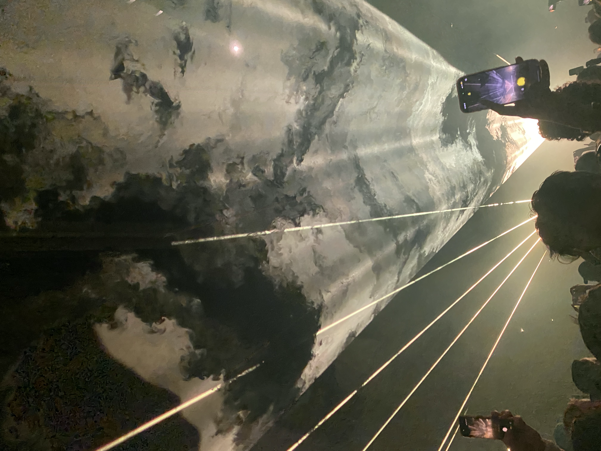

---
{"dg-publish":true,"permalink":"/daily-entry/03-11-2026/","dg-note-properties":{"description":"sadness, money and bassline"}}
---

Dear Diary,

I think I'll give diary a whirl. It's a little less panopticon.

As I awoke and the sunlight hit my eyes, so too did a great sadness. I woke up at 8. Another 4-hour sleep. _I can't keep doing this_, I thought to myself. Unable to breathe properly after what was apparently a congested night. I had a dream that my deviated septum was more pronounced, probably my brain telling me something. The prospects for the day were bleak, so I forced myself back to sleep. Again, I awoke at 10, this time suicidal. I shut my blinds and went back to sleep. I woke up again at 1:30. Much better! I wrote an upload.

I uploaded it. This is a third revision because I am procrastinating. I have usually been writing first thing in the morning in place of when I would journal. I think I don't want to abandon my handwritten journal, as I have assembled quite the archive, so perhaps I will do my Daily Entry in the evening from now on.

I have a lot going on in my head. None pleasant.

It's 18:47, and I will go back to bed now. That is enough from me for today :(

### Addendum:
the previous versions heavily lamented my circumstances. I've since decided it will all be fine. I just need to rest. Money isn't real, the economy is time. Who knows what great thing now lays before me! What an excellent opportunity to redirect. 

>I got PT'd today, which included in my expensive gym membership. The PT wasn't giving me much initially but, after i decided to name my programme *Miss Hooch Movez It* he became very warm to me. He laughed at me constantly. Both when I was being intentionally funny and at my mannerisms too! This cheered me up hugely! I love nothing more than making people laugh. I much prefer to make people laugh than to laugh myself and i LOVE to laugh. At a party over here someone I was meeting for the first time said, 'you seem like someone who likes to laugh, i can tell that about you.' DUH, i thought to myself. doesn't everyone LOVE to laugh?..
>
>Sometimes i wonder if all my laughter is abrasive. Sometimes I laugh at things that really aren't funny. i have been insulted many times and only been able to meet said insult with roaring laughter. Often times I laugh at the absurdity of things:
>	Once my ex boyfriend was driving to a festival and his catalytic converter broke so he parked his car in a field, some weeks later we went to retrieve it. He stayed at my mums house with me and... decided to cancel his car insurance that morning (a very strange choice that i would have advised against) we drove to the field and stood in it, there was no car. We spoke to some people working nearby, seems it had been stolen VERY recently. Perhaps even that morning. With no insurance, that was that. I could hardly stand I laughed so much, i laughed for hours. I laughed in McDonalds. I laughed the whole way home. I'm laughing now. I laugh very loudly and people often look. 

==I went to see Bicep (for free :P:P:P:P:P:) yesterday with my friends Ben and Maddy. I might write about this separately... for reasons undisclosed...==

> I thoroughly enjoyed it, particularly the lasers. Although I had a few moments of total dissociation doom and gloom;*the world is burning and we're entertaining ourselves to death* type beat.

Anyway, I already knew bass makes me incredibly horny and sometimes makes me cum. Which is obviously pleasurable but I also find slightly uncouth. I found this indecent in the underpass...  full of strangers, entirely without their knowledge or participation. I can't help it though! The music skips my brain completely and goes straight to some more primitive bit of me. My body gets it before I've had a chance to think... there will be more on this later. Do other people experience this? I asked Ben where his mind went during music like this, he said blank. I think that's common. I don't think it's my experience, I become extremely heightened within my body.

I felt euphoric, physically ecstatic, and a bit socially disinhibited. I knew it was indecent but I couldn't really control it. I felt primitive, totally at the mercy of my body, and at the same time I was looking at everyone else like animals in a zoo. Me the spectator, watching their funny little rituals and the way they moved, how easy they seemed to find being in their own bodies. And I was SO jealous! Jealous that they seemed to belong to something I can only ever watch and never join in with. Whatever these differences between us are, I can't seem to get past them. It's strange to feel so animal in myself and so alien among the other animals. Thank you Apricots. 

An interesting discovery... I'll ponder on some more. 

> [!NOTE]
> peace, love and joy!
> Miss Hooch
> 

#employment #music #sadgirl #money #EMDR