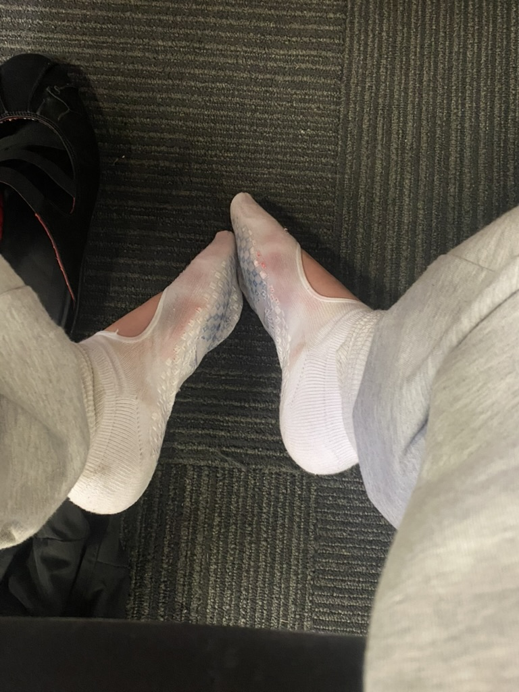

---
{"dg-publish":true,"permalink":"/daily-entry/04-11-2026/","dg-note-properties":{"description":"voice, colonialism, socks"}}
---

Dear Diary, 

>Last night I lay in bed and tried to think to myself...

>I have aphantasia, so this isn't quite as entertaining for me as I imagine it is for others. My thinking is different. My voice, not _my_ voice, but my voice of new and excited thoughts, hasn't been around for a while.

>She is the clever one, not me. She just speaks to me. Arrives out of nowhere and barges into my brain, uninvited and invariably welcome. I can't even think of an example because my voice isn't around to give me one :(

>She would encourage me to delve into myself, to ask **why** of everything. She was scarcely ever satisfied with an answer. She knew words without ever having learned them. In fact, she seemed to know things that were surely impossible to know. She had a sense. She had sense.

>Once, at a party, I was very drunk and talking to a friend's friend when my voice began to speak. She seemed to sense everything about this person: her home life, that she was a twin, what her fraternal twin looked like, her hopes and fears. This girl cried. I astounded myself, but it wasn't me who could take the credit. It was my voice.

>Everything interesting I have ever done, I owe to my voice.

>I have been without her for some time now. Maybe since the breakdown? I can't remember when she left. She disappeared so quietly that I thought perhaps she'd gone on holiday, but it's been rather longer than a holiday now. She comes back occasionally, just to remind me of what I'm missing. I liked it better when she was around all the time.

>I have to do everything myself now! She was a cheat code! She was my superpower! She was so clever, so interested in everything. She could make something of nothing, and now I sit with nothing, waiting for something to make itself.

>It is lonely without my voice.

>I lost my physical voice when I moved to this country, too. I found myself unable to speak aloud, paralysed by colonial shame and white guilt. People told me this was crazy. I thought it was crazy that they couldn't understand all the violence, murder and destruction my voice had caused. Or voices that sounded like mine.

>I am doing again what my cultural ancestors did. I am doing it again.

>I look down upon it. I educate myself against it. I condemn the machinery and yet find myself turning one of its little cogs. My very existence here participates in a system of oppression to which I am so vehemently opposed.

>This country pays respect to the traditional custodians of the land, and then allows me to come. To get a job. To live in the city. To increase prices. To take up space. I increase the divide. I cannot exist here neutrally.

>I do not dwell, but I occupy. Land stolen, people slaughtered, histories buried, so that I might occupy it for $1,000 a year on a Working Holiday Visa, subclass 417.

>What a peculiar little administrative arrangement for such an enormous inheritance.

>I know I am not the worst, but I am aware. So perhaps that makes me worse? To know, and to continue anyway?

>Maybe my voice is angry with me.

>Maybe she knows that I know this isn't the right life for me. The right place. Maybe she has grown tired of supplying clever thoughts to someone who doesn't know what to do with them. Maybe she is on strike. Maybe she's gone forever.

>Maybe I'll never have a new thought again?

>Maybe I am just feeling insecure?

>Maybe I am thinking through a prism of projection rather than simply thinking?

>Maybe I have mistaken exhaustion for an absence of intelligence?

>Maybe I am so preoccupied with listening for her that I can no longer hear myself?

>Maybe I am in my bell-jar again?

>Maybe it is because I am so tired.

>My tired little brain is being reprogrammed. It makes me sleepy. I cannot sleep.

>So last night, I lay in bed and tried to think to myself.
Goodbye, Miss Hooch. 

>PS: i am at the library and my socks are so wet they have gone tie-die. BRRRRRRRR! 
I did my weekly shop. $64. 7kg 2.6KM walk. 

#UpClose #sadgirl  #colonialism #hello